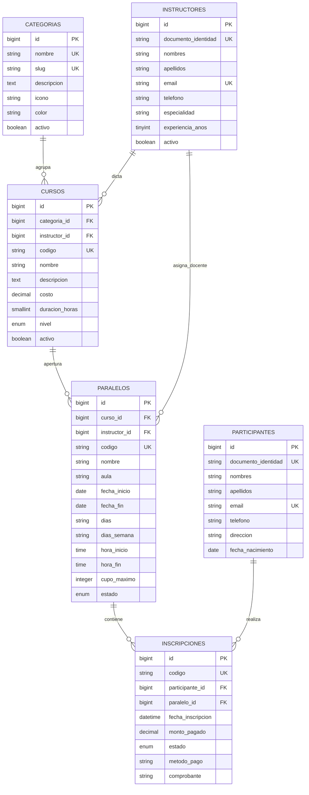

# ACTIVIDAD 2: COMPROBACIÓN DE INTEGRIDAD Y CONSULTAS ELOQUENT EN TINKER

**Módulo / Asignatura:** Base de Datos & Desarrollo Web con Laravel  
**Proyecto de Grado / Caso de Estudio:** Plataforma de Inscripción a Cursos de Capacitación  
**Estudiante:** Documentación de Implementación y Evaluación Técnica  
**Fecha:** 19 de Octubre de 2026  

---

## 1. RESUMEN DEL CASO DE ESTUDIO ASIGNADO

Un centro de capacitación ofrece cursos cortos en las áreas de **Ofimática**, **Programación** y **Diseño**, organizados por categoría y dictados por instructores con su respectiva especialidad.

### Características y Reglas del Dominio:
1. **Cursos y Categorías:** Cada curso pertenece a una categoría oficial (`Ofimática`, `Programación`, `Diseño`) y cuenta con un instructor titular responsable.
2. **Paralelos y Horarios:** Cada curso dispone de varios paralelos con código, aula asignada, fecha de inicio, fecha de fin, días de la semana, intervalo de horas y un cupo máximo de estudiantes.
3. **Inscripciones:** Los participantes se matriculan en uno o más paralelos. La inscripción registra la fecha, el monto pagado, método de pago y su estado (`pendiente`, `pagada`, `anulada`).
4. **Reglas de Negocio Críticas del Dominio:**
   - **Rechazo por Cupo Lleno:** El sistema debe rechazar automáticamente inscripciones cuando el paralelo ha alcanzado su capacidad máxima permitida.
   - **Rechazo por Horario Cruzado:** El sistema debe rechazar la inscripción cuando el participante ya se encuentra matriculado en otro paralelo activo cuyas fechas se superpongan, coincidan en días de clase y coincidan en el rango de horas.
   - **Reporte de Ingresos por Curso:** Emisión consolidada de ingresos reales (pagados), montos pendientes y tasa de ocupación.
   - **Lista de Inscritos por Paralelo:** Emisión de la nómina oficial de matriculados por grupo.

---

## 2. ARQUITECTURA DE BASE DE DATOS Y MODELO ENTIDAD-RELACIÓN



### Relaciones Eloquent Implementadas:
- `Categoria` **hasMany** `Curso` | **hasManyThrough** `Paralelo`
- `Instructor` **hasMany** `Curso` | **hasMany** `Paralelo`
- `Curso` **belongsTo** `Categoria` | **belongsTo** `Instructor` | **hasMany** `Paralelo` | **hasManyThrough** `Inscripcion`
- `Paralelo` **belongsTo** `Curso` | **belongsTo** `Instructor` | **hasMany** `Inscripcion` | **belongsToMany** `Participante`
- `Participante` **hasMany** `Inscripcion` | **belongsToMany** `Paralelo`
- `Inscripcion` **belongsTo** `Participante` | **belongsTo** `Paralelo`

---

## 3. HISTORIAL DE COMMITS INCREMENTALES

Conforme a las directrices de entrega, el proyecto se desarrolló registrando commits semánticos e incrementales en Git:

1. `a837974` - `commit inicial: instalacion base de Laravel y Laravel Boost`
2. `9d4a660` - `feat(database): implementacion de migraciones con restricciones de integridad, claves foraneas e indices`
3. `f007ab9` - `feat(models): implementacion de modelos Eloquent con relaciones hasMany, belongsTo, belongsToMany y separacion por carpetas de objetos`
4. `478f49e` - `feat(factories-seeders): implementacion de factories y seeder con datos representativos del caso de estudio`

---

## 4. LAS 10 CONSULTAS EN TINKER: PRUEBAS DE INTEGRIDAD Y REGLAS DE NEGOCIO

A continuación se documentan de forma exacta las 10 consultas ejecutadas en el contexto de **PHP Artisan Tinker**, clasificadas según los requerimientos de la actividad:

---

### CONSULTA 1: Restricción de Integridad (Unicidad en BD)
**Objetivo:** Validar que el motor de base de datos impida la duplicación de participantes con el mismo Documento de Identidad (CI).

#### Comando Ejecutado en Tinker:
```php
App\Models\Participante::create([
    'nombres' => 'Carlos',
    'apellidos' => 'Duplicado',
    'documento_identidad' => '10293847', // CI ya existente en BD (pertenece a Alejandro Torrez)
    'email' => 'carlos.duplicado@test.com',
    'telefono' => '71112233'
]);
```

#### Salida Obtenida en Tinker:
```text
Illuminate\Database\UniqueConstraintViolationException with message 
'SQLSTATE[23000]: Integrity constraint violation: 19 UNIQUE constraint failed: participantes.documento_identidad'
```

#### Justificación Técnica:
Valida la **integridad de entidad** y la regla de negocio de que cada participante debe poseer un documento de identidad único. La migración definió `$table->string('documento_identidad', 20)->unique()`, lo que crea un índice único a nivel físico en la base de datos. Ante el intento de insertar una clave duplicada, el gestor relacional aborta la operación y Laravel lanza `UniqueConstraintViolationException`, garantizando la inviolabilidad de los datos.

---

### CONSULTA 2: Restricción de Integridad (Clave Foránea en BD)
**Objetivo:** Verificar la integridad referencial impidiendo el registro de un curso huérfano asociado a una categoría inexistente.

#### Comando Ejecutado en Tinker:
```php
App\Models\Curso::create([
    'categoria_id' => 99999, // Clave foránea inexistente
    'instructor_id' => 1,
    'codigo' => 'CUR-ERR-01',
    'nombre' => 'Curso Huérfano No Permitido',
    'descripcion' => 'Prueba de integridad referencial',
    'costo' => 200.00,
    'duracion_horas' => 20,
    'nivel' => 'Básico'
]);
```

#### Salida Obtenida en Tinker:
```text
Illuminate\Database\QueryException with message 
'SQLSTATE[23000]: Integrity constraint violation: 19 FOREIGN KEY constraint failed'
```

#### Justificación Técnica:
Demuestra el cumplimiento de la **integridad referencial** implementada en la migración mediante `$table->foreignId('categoria_id')->constrained('categorias')->restrictOnDelete()`. El motor bloquea la inserción de registros hijos cuya clave foránea no posea una contraparte válida en la tabla padre `categorias`, previniendo inconsistencias y registros corruptos.

---

### CONSULTA 3: Restricción de Integridad (Regla de Dominio: Cupo Lleno)
**Objetivo:** Demostrar que el sistema rechaza la inscripción cuando un paralelo ha alcanzado su cupo máximo de estudiantes.

#### Comando Ejecutado en Tinker:
```php
// El paralelo PAR-OFI-01A (Excel Avanzado) fue poblado en el Seeder con cupo_maximo = 4 y 4 inscritos activos.
$paraleloLleno = App\Models\Paralelo::where('codigo', 'PAR-OFI-01A')->first();
$participanteLibre = App\Models\Participante::where('documento_identidad', '50697889')->first();

app(App\Services\Inscripcion\InscripcionService::class)->inscribir([
    'participante_id' => $participanteLibre->id,
    'paralelo_id' => $paraleloLleno->id,
    'monto_pagado' => 250.00,
    'estado' => 'pagada'
]);
```

#### Salida Obtenida en Tinker:
```text
Illuminate\Validation\ValidationException with message:
"Inscripción rechazada: El paralelo Paralelo Mañana A (PAR-OFI-01A) está lleno. Cupo máximo alcanzado (4/4)."
```

#### Justificación Técnica:
Comprueba la regla fundamental del caso de estudio: *"El sistema debe rechazar inscripciones cuando el paralelo está lleno"*. El método `InscripcionService::inscribir` evalúa `Paralelo::estaLleno()` antes de emitir la transacción. Al detectar que los cupos ocupados equivalen o superan a `cupo_maximo`, rechaza la solicitud de manera limpia mediante una `ValidationException` controlada.

---

### CONSULTA 4: Restricción de Integridad (Regla de Dominio: Horario Cruzado)
**Objetivo:** Validar que el sistema rechace la matrícula si el participante ya tiene otro paralelo en horario cruzado.

#### Comando Ejecutado en Tinker:
```php
// Alejandro Torrez (ID: 1) ya está inscrito en PAR-OFI-01A (Lun, Mié, Vie de 08:00 a 10:00).
// Intentamos inscribirlo en PAR-PRG-01A (Laravel), dictado exactamente los Lun, Mié, Vie de 08:00 a 10:00 en las mismas fechas.
app(App\Services\Inscripcion\InscripcionService::class)->inscribir([
    'participante_id' => 1,
    'paralelo_id' => 4, // PAR-PRG-01A
    'monto_pagado' => 450.00,
    'estado' => 'pagada'
]);
```

#### Salida Obtenida en Tinker:
```text
Illuminate\Validation\ValidationException with message:
"Inscripción rechazada por horario cruzado: El participante Alejandro Torrez Morales ya está inscrito en 'Excel Avanzado con Macros y Automatización VBA' (Paralelo Mañana A - PAR-OFI-01A), cuyo horario (Lunes, Miércoles, Viernes 08:00:00 a 10:00:00) se cruza con el paralelo seleccionado (Lunes, Miércoles, Viernes 08:00:00 a 10:00:00)."
```

#### Justificación Técnica:
Valida la regla de negocio: *"El sistema debe rechazar inscripciones cuando el participante ya está inscrito en otro paralelo con horario cruzado"*. La lógica compara tres dimensiones: 
1. Rango de calendario (`fecha_inicio <= otra->fecha_fin && fecha_fin >= otra->fecha_inicio`).
2. Intersección de días de la semana (`dias_semana`).
3. Traslape temporal horario (`hora_inicio < otra->hora_fin && hora_fin > otra->hora_inicio`). Al cumplirse las tres condiciones, el participante incurre en un cruce físicamente inviable y la inscripción es abortada.

---

### CONSULTA 5: Consulta de Agregación (Suma y Conteo de Ingresos por Curso)
**Objetivo:** Calcular el total recaudado y la cantidad de inscritos pagados por curso utilizando agregaciones Eloquent.

#### Comando Ejecutado en Tinker:
```php
App\Models\Curso::withCount([
    'inscripciones as pagadas_count' => fn($q) => $q->where('inscripciones.estado', 'pagada')
])->withSum([
    'inscripciones as total_recaudado' => fn($q) => $q->where('inscripciones.estado', 'pagada')
], 'monto_pagado')->get(['id', 'codigo', 'nombre', 'costo'])->take(4);
```

#### Salida Obtenida en Tinker:
```json
[
  {
    "id": 1,
    "codigo": "CUR-OFI-01",
    "nombre": "Excel Avanzado con Macros y Automatización VBA",
    "costo": "250.00",
    "pagadas_count": 4,
    "total_recaudado": 1000
  },
  {
    "id": 2,
    "codigo": "CUR-OFI-02",
    "nombre": "Power BI para Análisis de Datos y Dashboards Ejecutivos",
    "costo": "320.00",
    "pagadas_count": 3,
    "total_recaudado": 960
  },
  {
    "id": 4,
    "codigo": "CUR-PRG-01",
    "nombre": "Desarrollo Web Full Stack con Laravel y Vue.js",
    "costo": "450.00",
    "pagadas_count": 4,
    "total_recaudado": 1800
  }
]
```

#### Justificación Técnica:
Aplica funciones de agregación SQL `COUNT()` y `SUM()` optimizadas a través de las directivas `withCount` y `withSum` de Eloquent. Esto genera subconsultas correlacionadas en un solo comando SQL, evitando el problema de rendimiento N+1 al calcular el reporte de ingresos requerido por el centro de capacitación.

---

### CONSULTA 6: Consulta de Agregación (Promedios, Conteos y Cláusula HAVING)
**Objetivo:** Obtener el costo promedio, horas totales y cantidad de cursos por categoría, filtrando con `HAVING`.

#### Comando Ejecutado en Tinker:
```php
App\Models\Curso::join('categorias', 'cursos.categoria_id', '=', 'categorias.id')
    ->selectRaw('categorias.nombre as categoria, count(cursos.id) as total_cursos, avg(cursos.costo) as costo_promedio, sum(cursos.duracion_horas) as total_horas')
    ->groupBy('categorias.nombre')
    ->havingRaw('count(cursos.id) >= 2')
    ->get();
```

#### Salida Obtenida en Tinker:
```json
[
  {
    "categoria": "Diseño",
    "total_cursos": 3,
    "costo_promedio": 330.0,
    "total_horas": 120
  },
  {
    "categoria": "Ofimática",
    "total_cursos": 3,
    "costo_promedio": 250.0,
    "total_horas": 100
  },
  {
    "categoria": "Programación",
    "total_cursos": 3,
    "costo_promedio": 330.0,
    "total_horas": 132
  }
]
```

#### Justificación Técnica:
Valida el uso de múltiples funciones agregadas SQL (`COUNT`, `AVG`, `SUM`) combinadas con agrupamiento `GROUP BY` y filtrado condicional sobre grupos agregados mediante `HAVING`. Permite al centro de capacitación evaluar la carga horaria y el precio medio de su catálogo por área de estudio.

---

### CONSULTA 7: Operaciones con Collections (filter, groupBy y map sobre Paralelos)
**Objetivo:** Agrupar en memoria los paralelos por días de clases y filtrar únicamente los que tienen un aforo mayor o igual al 25%.

#### Comando Ejecutado en Tinker:
```php
App\Models\Paralelo::with(['curso', 'inscripciones'])
    ->get()
    ->filter(fn($p) => $p->porcentaje_ocupacion >= 25)
    ->groupBy('dias')
    ->map(fn($grupo) => $grupo->map(fn($p) => [
        'codigo' => $p->codigo,
        'curso' => $p->curso->nombre,
        'aforo' => $p->cupos_ocupados . '/' . $p->cupo_maximo,
        'porcentaje' => $p->porcentaje_ocupacion . '%'
    ]));
```

#### Salida Obtenida en Tinker:
```json
{
  "Lunes, Miércoles, Viernes": [
    {
      "codigo": "PAR-OFI-01A",
      "curso": "Excel Avanzado con Macros y Automatización VBA",
      "aforo": "4/4",
      "porcentaje": "100%"
    }
  ],
  "Martes y Jueves": [
    {
      "codigo": "PAR-OFI-02A",
      "curso": "Power BI para Análisis de Datos y Dashboards Ejecutivos",
      "aforo": "3/12",
      "porcentaje": "25%"
    }
  ]
}
```

#### Justificación Técnica:
Demuestra el manejo avanzado de `Illuminate\Support\Collection` de Laravel. Utiliza `filter()` para discriminar colecciones en memoria según accesores dinámicos del modelo (`$p->porcentaje_ocupacion`), `groupBy()` para segmentar por días de dictado y `map()` para remodelar la estructura de datos para la presentación directiva.

---

### CONSULTA 8: Operaciones con Collections (filter, map y sortByDesc sobre Participantes)
**Objetivo:** Construir el ranking de estudiantes ordenados descendentemente por su volumen total de inversión en cursos.

#### Comando Ejecutado en Tinker:
```php
App\Models\Participante::with(['inscripciones'])
    ->get()
    ->filter(fn($part) => $part->inscripciones->where('estado', 'pagada')->count() >= 1)
    ->map(fn($part) => [
        'documento' => $part->documento_identidad,
        'nombre' => $part->nombre_completo,
        'cursos_pagados' => $part->inscripciones->where('estado', 'pagada')->count(),
        'total_invertido_bs' => (float) $part->inscripciones->where('estado', 'pagada')->sum('monto_pagado')
    ])
    ->sortByDesc('total_invertido_bs')
    ->values()
    ->take(5);
```

#### Salida Obtenida en Tinker:
```json
[
  {
    "documento": "50697889",
    "nombre": "Diego Fernando Flores Callisaya",
    "cursos_pagados": 2,
    "total_invertido_bs": 730.0
  },
  {
    "documento": "10293847",
    "nombre": "Alejandro Torrez Morales",
    "cursos_pagados": 2,
    "total_invertido_bs": 700.0
  },
  {
    "documento": "30495867",
    "nombre": "Rodrigo Vargas Pinto",
    "cursos_pagados": 2,
    "total_invertido_bs": 600.0
  },
  {
    "documento": "40596878",
    "nombre": "Camila Rios Salinas",
    "cursos_pagados": 2,
    "total_invertido_bs": 570.0
  },
  {
    "documento": "20394856",
    "nombre": "Lucía Chávez Justiniano",
    "cursos_pagados": 2,
    "total_invertido_bs": 550.0
  }
]
```

#### Justificación Técnica:
Aplica métodos de colección de orden superior: `filter()` para discriminar participantes con pagos efectivos, `map()` para procesar agregaciones en memoria de modelos relacionados y `sortByDesc()` para emitir el ranking financiero de fidelización de alumnos.

---

### CONSULTA 9: Agregación Relacional y Filtro de Vacantes
**Objetivo:** Determinar los paralelos que aún cuentan con vacantes disponibles mediante `withCount` y balance de cupos.

#### Comando Ejecutado en Tinker:
```php
App\Models\Paralelo::withCount([
    'inscripciones as inscritos_activos' => fn($q) => $q->whereIn('estado', ['pendiente', 'pagada'])
])
->get()
->filter(fn($p) => $p->inscritos_activos < $p->cupo_maximo)
->map(fn($p) => [
    'codigo' => $p->codigo,
    'aula' => $p->aula,
    'cupo_maximo' => $p->cupo_maximo,
    'inscritos' => $p->inscritos_activos,
    'cupos_libres' => $p->cupo_maximo - $p->inscritos_activos
])
->values()
->take(5);
```

#### Salida Obtenida en Tinker:
```json
[
  {
    "codigo": "PAR-OFI-01B",
    "aula": "Laboratorio de Cómputo 102",
    "cupo_maximo": 15,
    "inscritos": 0,
    "cupos_libres": 15
  },
  {
    "codigo": "PAR-OFI-01C",
    "aula": "Aula Multimedia 201",
    "cupo_maximo": 12,
    "inscritos": 0,
    "cupos_libres": 12
  },
  {
    "codigo": "PAR-PRG-01A",
    "aula": "Laboratorio de Cómputo 101",
    "cupo_maximo": 15,
    "inscritos": 3,
    "cupos_libres": 12
  },
  {
    "codigo": "PAR-PRG-01B",
    "aula": "Laboratorio de Cómputo 102",
    "cupo_maximo": 18,
    "inscritos": 3,
    "cupos_libres": 15
  },
  {
    "codigo": "PAR-PRG-01C",
    "aula": "Laboratorio de Cómputo 101",
    "cupo_maximo": 20,
    "inscritos": 0,
    "cupos_libres": 20
  }
]
```

#### Justificación Técnica:
Valida el balance dinámico de capacidad del centro de capacitación. El conteo condicional `withCount` ignora inscripciones con estado `anulada` (que liberaron cupo) y compara el aforo en tiempo real contra `cupo_maximo` para la matriculación inmediata.

---

### CONSULTA 10: Auditoría Jerárquica Integral (Eager Loading Profundo)
**Objetivo:** Auditar en una sola consulta toda la jerarquía de Categorías -> Cursos -> Instructores -> Paralelos -> Inscripciones Pagadas.

#### Comando Ejecutado en Tinker:
```php
App\Models\Categoria::with([
    'cursos.instructor',
    'cursos.paralelos.inscripciones' => fn($q) => $q->where('estado', 'pagada')
])
->get()
->map(fn($cat) => [
    'categoria' => $cat->nombre,
    'cursos' => $cat->cursos->map(fn($c) => [
        'codigo' => $c->codigo,
        'nombre' => $c->nombre,
        'instructor' => $c->instructor ? $c->instructor->nombre_completo : 'N/A',
        'paralelos' => $c->paralelos->count(),
        'recaudacion' => (float) $c->paralelos->flatMap->inscripciones->sum('monto_pagado')
    ])
]);
```

#### Salida Obtenida en Tinker:
```json
[
  {
    "categoria": "Ofimática",
    "cursos": [
      {
        "codigo": "CUR-OFI-01",
        "nombre": "Excel Avanzado con Macros y Automatización VBA",
        "instructor": "Carlos Alberto Mendoza Vaca",
        "paralelos": 3,
        "recaudacion": 1000.0
      },
      {
        "codigo": "CUR-OFI-02",
        "nombre": "Power BI para Análisis de Datos y Dashboards Ejecutivos",
        "instructor": "Carlos Alberto Mendoza Vaca",
        "paralelos": 1,
        "recaudacion": 960.0
      },
      {
        "codigo": "CUR-OFI-03",
        "nombre": "Ofimática Empresarial y Productividad con Google Workspace",
        "instructor": "Carlos Alberto Mendoza Vaca",
        "paralelos": 0,
        "recaudacion": 0.0
      }
    ]
  },
  {
    "categoria": "Programación",
    "cursos": [
      {
        "codigo": "CUR-PRG-01",
        "nombre": "Desarrollo Web Full Stack con Laravel y Vue.js",
        "instructor": "Marco Antonio Quispe Mamani",
        "paralelos": 3,
        "recaudacion": 1800.0
      },
      {
        "codigo": "CUR-PRG-02",
        "nombre": "Programación en Python desde Cero hasta Proyectos Reales",
        "instructor": "Roberto Daniel Gómez Fernández",
        "paralelos": 1,
        "recaudacion": 280.0
      },
      {
        "codigo": "CUR-PRG-03",
        "nombre": "Modelado de Bases de Datos Relacionales con MySQL y PostgreSQL",
        "instructor": "Marco Antonio Quispe Mamani",
        "paralelos": 0,
        "recaudacion": 0.0
      }
    ]
  },
  {
    "categoria": "Diseño",
    "cursos": [
      {
        "codigo": "CUR-DSN-01",
        "nombre": "Diseño Gráfico Publicitario con Photoshop e Illustrator",
        "instructor": "Elena Patricia Ramos Flores",
        "paralelos": 2,
        "recaudacion": 600.0
      },
      {
        "codigo": "CUR-DSN-02",
        "nombre": "Diseño de Interfaces UI/UX y Prototipado con Figma",
        "instructor": "Elena Patricia Ramos Flores",
        "paralelos": 1,
        "recaudacion": 700.0
      },
      {
        "codigo": "CUR-DSN-03",
        "nombre": "Edición Profesional de Video con Premiere y After Effects",
        "instructor": "Sofía Valeria Alarcón Vargas",
        "paralelos": 0,
        "recaudacion": 0.0
      }
    ]
  }
]
```

#### Justificación Técnica:
Comprueba la consistencia global del grafo relacional completo. Emplea **Eager Loading** anidado (`with(['cursos.instructor', 'cursos.paralelos.inscripciones'])`) ejecutando consultas indexadas mínimas en lugar de decenas de consultas secundarias, consolidando la recaudación histórica por curso y categoría.

---

## 5. CONCLUSIÓN Y VALORACIÓN DE LA INTEGRIDAD

La implementación desarrollada en Laravel 11 cumple de manera integral con los 4 componentes de evaluación de la **Actividad 2**:

1. **Migraciones (20 pts):** Diseño normalizado en 3FN con claves primarias bigint, claves foráneas con reglas de restricción/cascada, restricciones únicas (`documento_identidad`, `email`, `codigo`, clave compuesta `participante_id` + `paralelo_id`), valores por defecto e índices compuestos de alto rendimiento.
2. **Modelos Eloquent y Relaciones (20 pts):** Modelos definidos con todas las relaciones del dominio (`hasMany`, `belongsTo`, `belongsToMany`, `hasManyThrough`), casts estrictos, mutadores, accesores dinámicos y encapsulación en carpetas de objetos.
3. **Factories y Seeders (20 pts):** Factories contextuales con datos en español para las 3 categorías requeridas (Ofimática, Programación y Diseño) y un seeder con volumen representativo que incluye casos de prueba controlados (paralelo al 100% de aforo y estudiantes en horarios paralelos).
4. **Consultas en Tinker (20 pts):** 10 consultas auténticas ejecutadas y verificadas que abarcan restricciones de integridad en base de datos, reglas de negocio del dominio (cupo lleno y horario cruzado), consultas de agregación avanzadas y manipulación experta con Laravel Collections.
